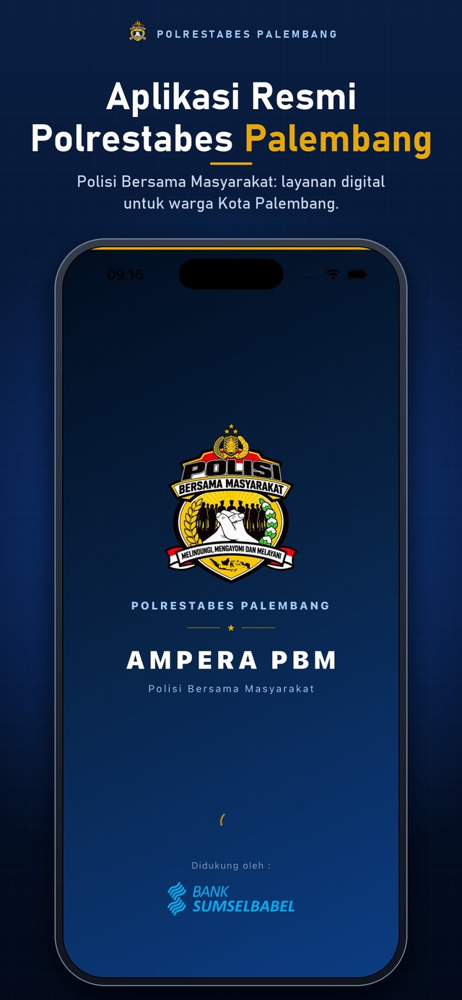
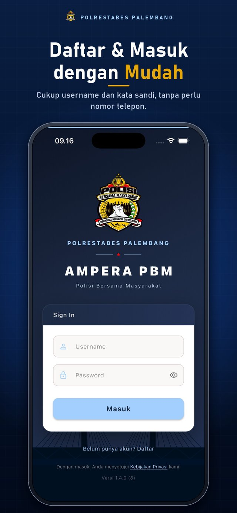
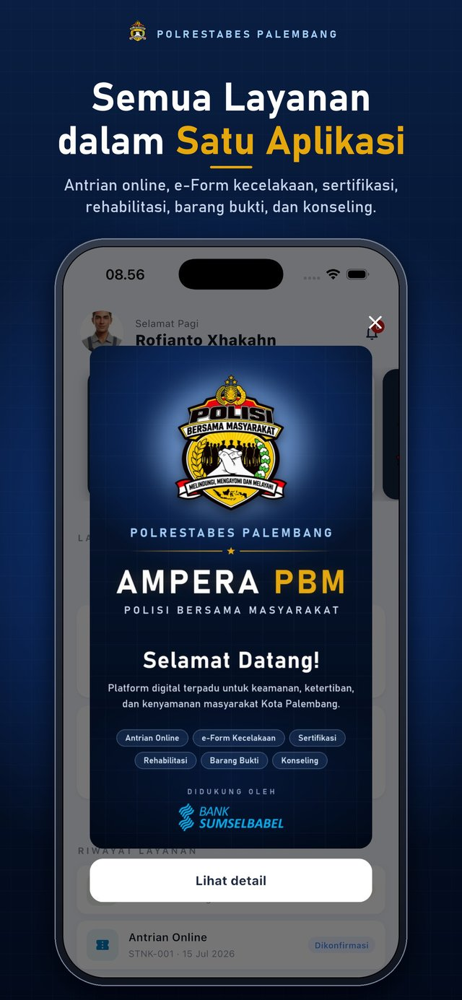
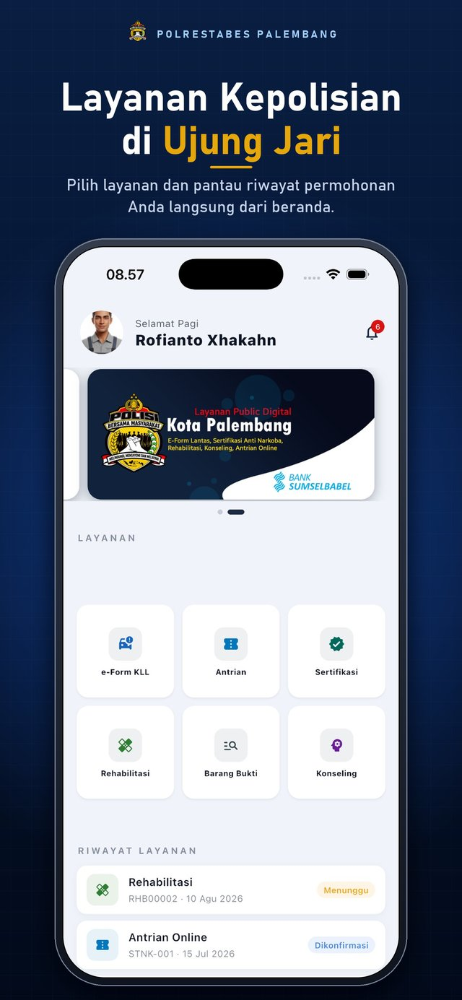
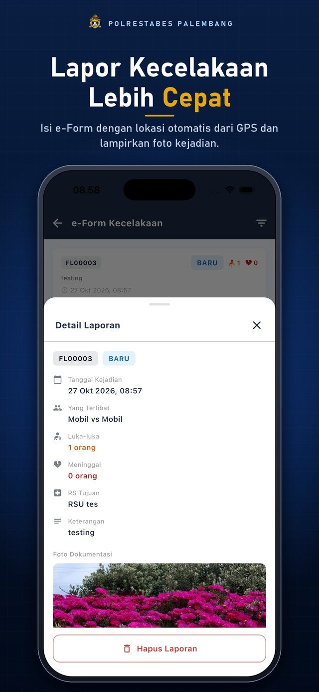

<div align="center">


# AMPERA PBM

**Polisi Bersama Masyarakat** — aplikasi layanan publik digital Polrestabes Palembang
untuk Android dan iOS

[](https://flutter.dev)
[](#)
[](pubspec.yaml)

### Coba aplikasinya (demo)

[](https://play.google.com/store/apps/details?id=id.polisibaik.ampera247)
[](https://apps.apple.com/id/app/ampera-pbm/id6797996590)

</div>

---

## Tentang

**AMPERA PBM** memudahkan warga Palembang mengakses layanan Polrestabes Palembang dari
ponsel: mengambil antrian, melaporkan kecelakaan, berkonsultasi, mengikuti tes sertifikasi,
dan lainnya. Aplikasi terhubung ke backend **Digital Kamtibmas** (Odoo 19).

Aplikasi ini berada di bawah tanggung jawab Polrestabes Palembang dan dikembangkan serta
dikelola secara teknis oleh CV. Mitra Hoki Maju Mapan, berdasarkan Surat Pernyataan
Kapolrestabes Palembang No. B/1718/X/2026 tanggal 20 Oktober 2026.

> Backend ada di repositori terpisah:
> **[digital-kamtibmas](https://github.com/rofianto507/digital-kamtibmas)** (modul Odoo 19).

## Tampilan

<table>
  <tr>
    <td align="center" width="20%"></td>
    <td align="center" width="20%"></td>
    <td align="center" width="20%"></td>
    <td align="center" width="20%"></td>
    <td align="center" width="20%"></td>
  </tr>
  <tr>
    <td align="center"><sub>Layar pembuka</sub></td>
    <td align="center"><sub>Daftar &amp; masuk</sub></td>
    <td align="center"><sub>Layar sambut</sub></td>
    <td align="center"><sub>Beranda layanan</sub></td>
    <td align="center"><sub>Lapor kecelakaan</sub></td>
  </tr>
</table>

> Data pada tangkapan layar adalah data uji.

## Fitur

| Layanan | Kegunaan |
|---|---|
| **Antrian online** | Pilih jenis layanan dan jadwal, dapatkan nomor antrian, pantau statusnya. |
| **e-Form Laka** | Laporkan kecelakaan lalu lintas dengan foto, jumlah korban, rumah sakit tujuan, dan titik lokasi di peta (GPS). |
| **Konseling online** | Ajukan konsultasi, lalu berobrolan dan panggilan video dengan petugas. |
| **Rehabilitasi** | Ajukan permohonan rehabilitasi dan pantau jadwalnya. |
| **Sertifikasi online** | Lihat daftar tes sertifikasi dan ikuti tes daring. |
| **Barang bukti** | Cari informasi barang bukti. |
| **Patroli** | Untuk petugas patroli: mulai dan selesaikan patroli, lokasi tim terkirim ke dashboard (juga saat aplikasi di latar belakang). |
| **Notifikasi** | Pemberitahuan perkembangan layanan Anda. |
| **Profil** | Ubah nama dan foto, keluar, atau ajukan hapus akun. |

Lainnya: pendaftaran dengan *username* dan kata sandi, layar sambut serta banner beranda
yang dapat diatur dari backend, dan sesi yang berakhir otomatis diarahkan ke halaman masuk.

## Teknologi

| Bagian | Pustaka |
|---|---|
| Kerangka | Flutter, Dart `^3.12.2` |
| State management | `flutter_riverpod` (provider manual, tanpa *code generation*) |
| Navigasi | `go_router` |
| Jaringan | `dio` dengan *interceptor* sesi |
| Penyimpanan aman | `flutter_secure_storage` (sesi dan data masuk) |
| Peta dan lokasi | `flutter_map`, `latlong2`, `geolocator`, `flutter_foreground_task` |
| Konseling (obrolan dan video) | `webview_flutter` (Odoo Discuss) |
| Izin dan berkas | `permission_handler`, `file_picker`, `url_launcher` |
| Model data | `freezed`, `json_serializable` |

Target: Android (`compileSdk 36`, JDK 17), iOS (*deployment target* 13.0), serta web untuk pengujian.

## Struktur kode

Per fitur, dengan lapisan `data` / `domain` / `presentation`:

```
lib/
├── main.dart
├── core/
│   ├── config/      # AppConfig: BASE_URL, DB_NAME, IS_PRODUCTION (dart-define)
│   ├── network/     # ApiClient, interceptor sesi
│   ├── router/      # go_router
│   ├── theme/       # tema aplikasi
│   └── platform/, utils/   # pemilih foto, buka URL, waktu Odoo (UTC → zona perangkat)
├── features/
│   ├── auth/  registration/  splash/  dashboard/  profile/  notifikasi/
│   ├── antrian/  eform_laka/  konseling/  rehab/
│   └── sertifikasi/  barang_bukti/  patroli/
└── shared/          # widget dan utilitas bersama
```

## Menjalankan untuk pengembangan

**Prasyarat:** Flutter SDK dengan Dart ≥ 3.12.2, Android Studio atau Xcode, dan backend
[Digital Kamtibmas](https://github.com/rofianto507/digital-kamtibmas) yang sudah berjalan.

```bash
git clone https://github.com/rofianto507/ampera247-mobile.git
cd ampera247-mobile
flutter pub get
```

Alamat server dan nama database diberikan lewat `--dart-define` (bukan di-*hardcode*):

| Berkas | Dipakai untuk | `BASE_URL` |
|---|---|---|
| `env.dev.json` | Emulator Android | `http://10.0.2.2:8069` |
| `env.web.json` | Browser (web) | `http://localhost:8069` |
| `env.prod.json` | Produksi (tidak ada di repositori) | domain server Anda |

```bash
# Emulator Android (atau skrip run_dev.ps1)
flutter run --dart-define-from-file=env.dev.json

# Browser (atau skrip run_web.ps1)
flutter run -d web-server --dart-define-from-file=env.web.json --web-port=8080
```

Ubah `DB_NAME` pada berkas `env.*.json` sesuai nama database Odoo Anda.

## Build rilis

`env.prod.json` sengaja tidak disimpan di repositori. Buat sendiri:

```json
{
  "BASE_URL": "https://<domain-server-anda>",
  "DB_NAME": "<nama-database>",
  "IS_PRODUCTION": "true"
}
```

> **Penting:** build produksi wajib memakai `--dart-define-from-file=env.prod.json`. Tanpa itu
> aplikasi memakai nilai bawaan di `lib/core/config/app_config.dart`.

```bash
# Android App Bundle (Play Store)
flutter build appbundle --release --dart-define-from-file=env.prod.json

# iOS (jalankan di macOS)
flutter build ipa --release --dart-define-from-file=env.prod.json
```

**Penandatanganan Android:** buat `android/key.properties` (diabaikan git) berisi
`storeFile`, `storePassword`, `keyAlias`, dan `keyPassword`. Jangan pernah mengunggah
*keystore* atau berkas tersebut ke repositori.

**Versi:** ubah `version` di `pubspec.yaml` dengan format `versionName+versionCode`. Angka
setelah `+` wajib naik pada setiap unggahan ke Play Store.

## Izin yang digunakan

| Izin | Alasan |
|---|---|
| Lokasi | Titik lokasi e-Form Laka dan pelacakan patroli. Saat patroli berjalan, pelacakan memakai layanan latar depan (*foreground service*) dengan notifikasi yang tampil. |
| Kamera dan galeri | Foto e-Form Laka dan foto profil |
| Mikrofon dan kamera | Panggilan video konseling |
| Notifikasi | Menampilkan notifikasi aplikasi dan status pelacakan patroli |

## Kebijakan dan dukungan

- Kebijakan privasi: https://ampera2407.id/kebijakan-privasi
- Dukungan: https://ampera2407.id/dukungan
- Hapus akun: https://ampera2407.id/hapus-akun
- Informasi aplikasi: https://ampera2407.id/ampera247

## Pengembang

**CV Sel Studio** — https://selstudio.id · rofianto@selstudio.id

Dikelola secara teknis untuk Polrestabes Palembang oleh **CV. Mitra Hoki Maju Mapan** (Tim AMPERA PBM).
